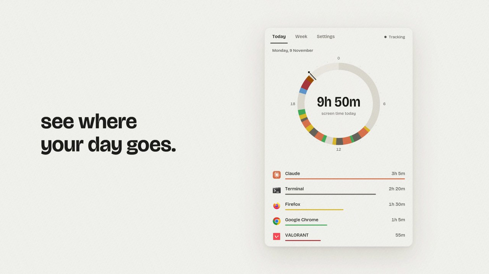
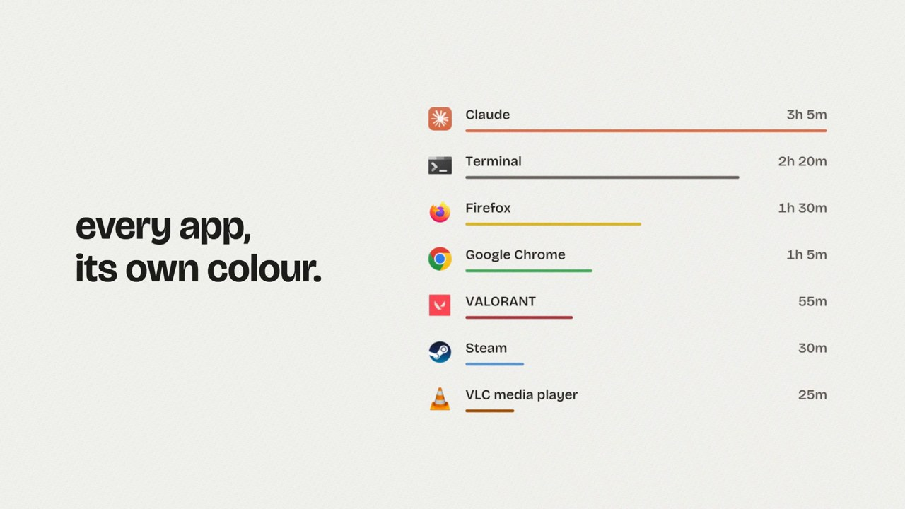
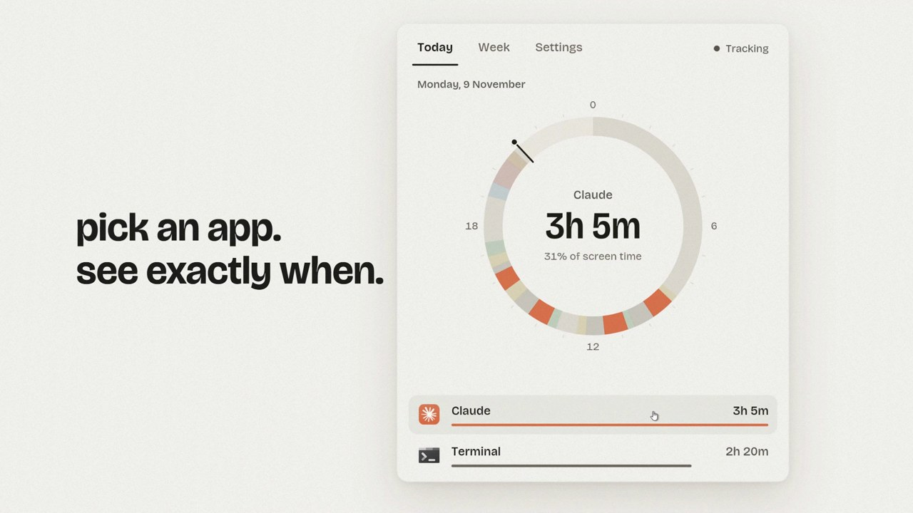

# Screentime


See where your day goes. A small, private screen time tracker for Windows, written in Rust.

### [Download for Windows](https://github.com/StarKnightt/screentime/releases/latest/download/Screentime.exe)

One file, no installer, free. For 64-bit Windows 11 (see [Supported Windows versions](#supported-windows-versions)).



## Install

1. Download `Screentime.exe` and put it somewhere you will keep it, for example a folder in Documents.
2. Double-click it. The window opens and tracking starts. Start at login is turned on for you.

The exe is not code signed, so Windows may show "Windows protected your PC". Click **More info**, then **Run anyway**. See [Windows says it's unsafe?](#windows-says-its-unsafe)

Closing the window keeps Screentime in the tray. Click the tray icon to open it again.

## Features

- **Your day on a 24-hour dial.** Every app gets its own colour, taken from its icon, so you can see at a glance what filled each hour.
- **Time per app.** A ranked list with the total for today.
- **Pick an app, see exactly when.** Click an app and the dial shows only its slices.
- **Week view.** The last seven days side by side, plus your most used apps.
- **Counts only real use.** Idle time is subtracted (you choose after how long), locked screens are not counted, and pop-ups and hidden windows are ignored.
- **Pause** from the tray or Settings, **light and dark** themes, and **export** of every session to CSV or JSON.





## Light on your PC

Measured on Windows 11 while tracking normal use:

| | |
|---|---|
| Memory | 9.6 MB (8.1 MB for the separate tracker in a source build) |
| CPU | ~0% |
| Network | none (0 connections) |

It is pure Rust and native Windows code: no browser engine and no background service.

## Privacy

Everything stays on your PC. Screentime makes no network connections at all: no account, no telemetry, no updates check.

Your data lives in one SQLite file:

```
%LOCALAPPDATA%\screentime\data.db
```

Settings are in `config.ini` in the same folder.

## What it never stores

Screentime never records window titles, web addresses (URLs), keystrokes or screenshots. For each app it stores only the app's name and the path of its exe, and for each stretch of use only a start and an end time. To notice when you are idle it asks Windows how long ago your last input was, never what it was.

Next to the database there is a small `config.ini` with your settings, and a `tracker.log` that is only written if something goes wrong (it may name an exe path).

## How it works

A small windowless tracker checks the foreground window once a second and records which app it belongs to. It only counts a window that is visible, not minimized, not hidden by Windows, and not a tool window or pop-up, and it stops counting when you are idle or the screen is locked. Sessions are written to the database every 30 seconds and when the tracker stops, so a crash loses at most half a minute.

The window you see is a separate process that reads the same database read-only. "Start at login" runs only the tracker (`Screentime.exe --tracker`), using a normal entry under `HKEY_CURRENT_USER\...\Run`. No admin rights are needed.

## Supported Windows versions

- **Windows 11, 64-bit:** tested.
- **Windows 10, 64-bit:** should work (it is the oldest version the Rust toolchain supports), but it has not been tested yet. If you try it, please open an issue either way.
- **Windows 8.1 and older, 32-bit and ARM:** not supported.

## Windows says it's unsafe?

Screentime is not code signed, because a signing certificate costs money every year. Windows SmartScreen warns about any unsigned exe it has not seen many times before, and shows "Windows protected your PC".

To run it anyway, click **More info**, then **Run anyway**. You only need to do this once.

If you want to check the file first:

- VirusTotal scan: [VIRUSTOTAL_LINK](VIRUSTOTAL_LINK)
- The SHA256 hash of each release file is in the [release notes](https://github.com/StarKnightt/screentime/releases/latest). In PowerShell: `Get-FileHash .\Screentime.exe`
- Or [build it from source](#build-from-source).

## Updates

No auto-update, on purpose: Screentime never connects to the internet. Watch or star the repo to hear about new releases.

## Roadmap

- Microsoft Store release.

Export of your data to CSV or JSON is already available in Settings.

## Feedback

Found a bug? [Open an issue](https://github.com/StarKnightt/screentime/issues).

## Uninstall

1. Open Screentime, go to **Settings** and turn off **Start at login**.
2. Right-click the tray icon and choose **Stop tracking and quit**.
3. Delete `Screentime.exe`.
4. To remove your data too, delete the folder `%LOCALAPPDATA%\screentime`.

If you moved `Screentime.exe` after the first run, turn **Start at login** off and on again in Settings so it points to the new place.

## Build from source

You need [Rust](https://rustup.rs) (the toolchain version is pinned in `rust-toolchain.toml`) and the MSVC build tools.

```
git clone https://github.com/StarKnightt/screentime
cd screentime
cargo build --release
```

This builds three programs in `target\release`:

- `screentime-app.exe`: the app. This is the file released as `Screentime.exe`. It also runs the tracker when started with `--tracker`.
- `screentime-tracker.exe`: the tracker on its own. If it sits next to the app, the app uses it instead of `--tracker`.
- `screentime.exe`: a command line tool (`screentime today`, `week`, `status`, `run`, `stop`, `pause`, `resume`, `startup on|off`, `export --csv|--json`).

Run the tests with `cargo test --workspace`.

Code layout:

- `core`: the tracker state machine, Win32 probes, SQLite storage, reports, export and settings.
- `gui`: the desktop app, built with [iced](https://iced.rs).
- `cli`: the command line tool and the standalone tracker.

## License

MIT. See [LICENSE](LICENSE). The bundled Bricolage Grotesque font is under the SIL Open Font License (`gui/assets/fonts/OFL-Bricolage.txt`).
